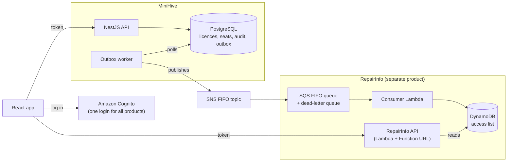

# MiniHive

A small licence and seat management platform. It shows how a company that sells several software products can control **who is allowed to use which product**.

**The idea:** organisations, such as a garage, buy a **licence** for a product, such as *RepairInfo* (repair data for mechanics). A licence comes with a number of **seats**, and the organisation's admin gives those seats to their staff. The product keeps **its own list** of who has access, and MiniHive keeps that list up to date **by sending events**. When a user opens the product, it checks its own list and never has to call MiniHive.

```
Platform admin  →  creates Garage A and sells it a RepairInfo licence with 2 seats
Garage admin    →  gives one of those seats to Dave
RepairInfo      →  a few seconds later, Dave can open it
```

## Architecture



### What happens when a seat is assigned

1. **Bob**, the admin of Garage A, gives **Dave** a seat in the web app.
2. The API checks Bob's permissions, then calls the `assign_seat` database function. In one transaction, it locks the licence, checks there's a free seat, saves the seat and writes a `SeatAssigned` event to the **outbox** table.
3. The **worker** picks up the event and publishes it to **SNS**.
4. **SQS** delivers it to the **consumer Lambda**, which adds Dave to RepairInfo's access list in **DynamoDB**.
5. Dave opens RepairInfo. Its API checks his Cognito token and finds him on the list.

## Tech stack

| Part        | Technology                                                   |
| ----------- | ------------------------------------------------------------ |
| Frontend    | React, Vite, react-oidc-context                              |
| API         | NestJS, TypeScript                                           |
| Database    | PostgreSQL with PL/pgSQL functions and triggers              |
| Login       | Amazon Cognito                                               |
| Events      | Transactional outbox, SNS FIFO, SQS FIFO with a dead-letter queue |
| Product     | AWS Lambda, DynamoDB                                         |
| Infra       | AWS CDK                                                      |
| Tests       | Jest                                                         |

## Key decisions

- **Transactional outbox.** The seat and its event are saved in the same transaction, so an event is never lost and never sent for a change that was rolled back.
- **Seat rules live in the database.** `assign_seat` locks the licence row (`FOR UPDATE`), so two admins can't both take the last seat.
- **Audit trigger.** Every change to licences and seats is logged automatically, along with who made it.
- **Permissions are plain functions.** `can(user, action, orgId)` is a small table of rules with its own tests. A user from another organisation gets `404`, not `403`, so they can't tell the organisation exists.
- **FIFO, grouped by user.** Each user's events arrive in order. With a standard queue, *assign → revoke → assign* once arrived with the revoke last, and the user lost access.
- **Safe to receive twice.** SQS can deliver a message more than once. The consumer records each event ID in the same DynamoDB transaction as the change, and skips repeats.
- **One login, separate products.** Cognito knows *who* you are. Each product decides *what* you can open from its own data.

## Project structure

```
apps/
  api/       NestJS API: auth, permissions, organisations, seats
  web/       React app
  worker/    publishes outbox events to SNS
infra/
  db/        migrations and seed data
  cdk/       AWS stacks (Cognito, provisioning) and Lambda code
  scripts/   creates the seed users in Cognito
```

## Running it locally

You need Node 24, Docker and an AWS account. CDK uses the AWS profile `minihive`, set in [`infra/cdk/cdk.json`](infra/cdk/cdk.json).

```bash
cp .env.example .env
npm install
docker compose up -d                    # Postgres
npm run db:migrate && npm run db:seed

aws sso login --profile minihive
npm run cdk -- deploy --all             # Cognito, SNS, SQS, Lambdas, DynamoDB
# copy the stack outputs into .env: COGNITO_*, SNS_TOPIC_ARN, REPAIRINFO_URL
npm run db:seed-users                   # creates the users below
```

On a new AWS account, run `npm run cdk -- bootstrap` once before deploying.

Then start each app in its own terminal:

```bash
npm run dev -w api       # http://localhost:3000
npm run dev -w worker
npm run dev -w web       # http://localhost:5173
```

Tests:

```bash
npm test -w api           # permission rules
npm run test:int -w api   # seat rules and the last-seat race, against a test database
```

## Seed accounts

All users log in with the `SEED_USER_PASSWORD` from your `.env`.

| Login                 | Who                | What they can do                                             |
| --------------------- | ------------------ | ------------------------------------------------------------ |
| `alice@minihive.test` | Platform admin     | Create organisations and sell them licences                  |
| `bob@minihive.test`   | Admin of Garage A  | Assign and revoke Garage A's seats, see its audit log        |
| `carol@minihive.test` | Member of Garage A | Holds a RepairInfo seat                                      |
| `dave@minihive.test`  | Member of Garage A | No seat yet: Bob can give him one                            |
| `erin@minihive.test`  | Admin of Garage B  | Garage B's licence has expired, so she can't assign seats    |

| Organisation | Licence    | Seats | Status  |
| ------------ | ---------- | ----- | ------- |
| Garage A     | RepairInfo | 2     | active  |
| Garage B     | RepairInfo | 1     | expired |

Carol's seat is created directly in the database, not through the app, so RepairInfo only learns about it once Bob revokes and reassigns it.

## Known limitations and next steps

- **Invitations:** there's no way to add users to a new organisation yet. The plan is email invites via SES (Mailpit locally).
- **Replaying old messages:** a message redriven from the dead-letter queue arrives late and could overwrite newer access. Version numbers with a conditional write would prevent this. There's also no alarm on the dead-letter queue yet.
- **Filtering events:** RepairInfo's queue receives events for every product. An SNS filter policy would limit it to its own.
- **Several licences for one product:** revoking one removes access even if the user still has a seat on another.
- **App clients:** each product should have its own Cognito app client, so a token for one can't be used on another.
- **Audit log:** the query scans JSON and isn't paginated.
